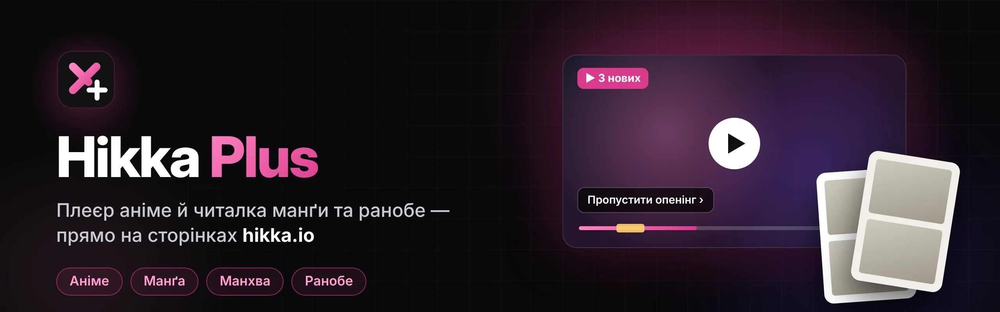

<div align="center">



<br>

[](https://github.com/M0npet/hikka-plus/releases)
[](https://github.com/M0npet/hikka-plus/actions/workflows/build.yml)
[](#-встановлення)
[](#-встановлення)
[](LICENSE)

**Неофіційне розширення для [hikka.io](https://hikka.io)** — плеєр аніме з українськими озвучками<br>
та читалка манґи, манхви й ранобе, вбудовані прямо в сторінку тайтлу й оформлені в стилі сайту.

[Встановлення](#-встановлення) · [Можливості](#-можливості) · [Джерела](#-джерела) · [Приватність](PRIVACY.md) · [Повідомити про помилку](https://github.com/M0npet/hikka-plus/issues)

</div>

> [!NOTE]
> Hikka Plus не пов'язане з командою Hikka. Контент береться лише з українських сайтів-джерел,
> їхній захист розширення не обходить. Власного сервера немає — нічого не надсилається розробнику.

## ✨ Можливості

<table>
<tr>
<td width="50%" valign="top">

### 🎬 Аніме — блок «Перегляд»

- Плеєри українських озвучок **прямо на сторінці аніме**, між «Опис» і «Головні персонажі»
- Команди й серії з **Mikai** та **AnimeON**; плеєри Ashdi, Moon, Fenix
- **«Ширше»** на всю сітку, на ширину вікна або на весь екран — без перезавантаження плеєра
- **Мітки опенінгу й ендингу**, кнопка «Пропустити», автопропуск
- **«Вимкнути світло»** і **підсвітка навколо плеєра** з кольорів кадру
- Серія зараховується в список Hikka з початку ендингу
- Плашки **«▶ N нових»** і **«N серія через X дн.»** на картках

</td>
<td width="50%" valign="top">

### 📖 Манґа, манхва, ранобе — читалка

- Блок **«Розділи»** на сторінці тайтлу: джерела, команди перекладу, томи, пошук
- **Читалка поверх сайту** — розділ в адресі, «Назад» і посилання працюють
- Манґа: стрічка або посторінково, справа наліво, **підсвітка** навколо сторінок
- Ранобе: теми, шрифт, розмір, інтервал, ширина
- **Прогрес** за номером розділу — не губиться при зміні джерела
- Лічильник у списку Hikka оновлюється сам
- Плашки **«▶ N нових розділів»** на картках «Читаю»

</td>
</tr>
</table>

**А ще:** синхронізація прогресу й налаштувань між пристроями (через синхронізацію браузера), сенсорні екрани й Firefox на Android,
кольори й шрифт — з теми Hikka, не заважає Hikka Features і Hikka Forge.

<details>
<summary><b>Усі можливості докладно</b></summary>

#### Аніме

- Сітка серій з позначками переглянутого (лічильник Hikka), перемикання команд і плеєрів, сенсорні екрани.
- «Ширше» на всю ширину сітки; у «Ширше» — «Розмір плеєра»: на всю ширину вікна або на всю висоту екрана; «На весь екран».
- Серія зараховується з початку ендингу (мітки плеєра → AniSkip з перевіркою → за 90 с до кінця); за бажанням — лічильник у списку Hikka.
- Мітки OP/ED: смужка під плеєром (мітки самого плеєра — Moon, Fenix; інакше приблизні з AniSkip), кнопка «Пропустити», автопропуск.
- Підсвітка навколо плеєра з країв кадру (вимикач, прозорість, яскравість).
- Експериментально: підсвітка пристроїв від відео — Philips Ambilight TV, WLED, Philips Hue, Razer Chroma (за замовчуванням вимкнено).

#### Манґа, манхва, ранобе

- Кнопка **«Читати / Продовжити»** у лівій колонці сторінки тайтлу (під «Додати у список»).
- Перемикач джерел з кількістю розділів на кожному, вибір команди перекладу, пошук за номером, сортування, томи.
- Смужка «прочитано N з M», у кожного розділу — кружечок стану (клік — позначити вручну); «Продовжити» відкриває там, де зупинився.
- Автопідбір тайтлу на джерелах (за посиланням із Hikka, MAL або за назвами) + ручна прив'язка.
- Ранобе — тема (як Hikka / темна / сепія / світла), шрифт, розмір, інтервал, ширина, відступи, вирівнювання.
- Манґа — стрічка або посторінково, напрям (у т. ч. справа наліво), вписування, ширина, відступи, яскравість, якість, зони кліку.
- Смужка прогресу розділу, місце в кожному розділі запам'ятовується, автопозначка «прочитано», клавіші ← → / F / Esc, повний екран;
  наступний розділ — тієї ж команди.
- **Синхронізація з Hikka** (вхід через OAuth): прочитані розділи оновлюють лічильник у списку Hikka.

</details>

## 📚 Джерела

Лише українські сайти. Якщо сайт захищає свою читалку — даємо посилання на нього, а не обходимо захист.

| | Сайти |
|---|---|
| **Манґа й манхва** | Zenko · Manga.in.ua · Honey Manga · UAManga · DGManga · Animesvit |
| **Ранобе** | Бака · Смаколики · Runi · NovelHub · FanVers · Wattpad (лише українською) |
| **Аніме** | Mikai · AnimeON (плеєри Ashdi, Moon, Fenix) |
| **Посиланням** | Mangra · FAUST · Mangarama · Dengeki |

## 📦 Встановлення

| Браузер | Як встановити |
|---|---|
|  | **addons.mozilla.org** — сторінка зараз на перевірці Mozilla, посилання з'явиться тут. Firefox 140+, Android 142+. |
|  | Поки без Chrome Web Store: архів `…-chrome.zip` з [Releases](https://github.com/M0npet/hikka-plus/releases) → розпакувати → `chrome://extensions` → «Режим розробника» → «Завантажити розпаковане». |

Після встановлення відкрийте будь-яке аніме чи манґу на [hikka.io](https://hikka.io) — блоки з'являться самі.
Налаштування — по іконці розширення.

## 🔒 Приватність

Розширення не має власного сервера й нічого не надсилає розробнику: ні аналітики, ні реклами.
Що й куди йде (джерела, Mikai, AniSkip, Hikka після входу) — у [PRIVACY.md](PRIVACY.md).

## 🛠️ Розробка

Потрібні Node.js 22 і npm. Стек: [WXT](https://wxt.dev) · TypeScript · Preact (`preact/compat`) · MV3 для Chrome, MV2 для Firefox.

```bash
git clone https://github.com/M0npet/hikka-plus.git
cd hikka-plus
npm install
npm run dev:firefox   # відкриє Firefox із розширенням (або: npm run dev — Chrome)
```

<details>
<summary><b>Збірка, змінні оточення</b></summary>

```bash
npm run build:firefox   # .output/firefox-mv2
npm run build           # .output/chrome-mv3
npm run zip:firefox && npm run zip   # архіви для магазинів
npm run compile         # перевірка типів
```

Клієнт OAuth Hikka необов'язковий: без змінних `WXT_HIKKA_CLIENT_REFERENCE` / `WXT_HIKKA_CLIENT_SECRET`
(файл `.env.local` або змінні оточення) розширення збирається й працює, лише без синхронізації з Hikka.

Тимчасово встановити зібране:

- **Firefox:** `about:debugging#/runtime/this-firefox` → «Тимчасово завантажити доповнення…» → `.output/firefox-mv2/manifest.json`.
- **Chrome:** `chrome://extensions` → «Режим розробника» → «Завантажити розпаковане» → `.output/chrome-mv3`.

</details>

<details>
<summary><b>Як додати джерело</b></summary>

1. Реалізуй `ReadSource` (`src/sources/types.ts`) у новому файлі, як `src/sources/zenko.ts`.
2. Додай його в `SOURCES` у `src/sources/registry.ts`.
3. Додай API-хост у `src/core/hosts.ts` (звідти будуються дозволи маніфесту).

</details>

<details>
<summary><b>Релізи</b></summary>

Збирає GitHub Actions (`.github/workflows/build.yml`):

- кожен пуш у `main` — перевірка типів і zip-архіви в артефактах запуску (вкладка **Actions**);
- тег `vX.Y.Z` — реліз у **Releases** з архівами для Firefox, Chrome і вихідним кодом (для AMO);
  якщо в секретах репо є `AMO_API_KEY` / `AMO_API_SECRET` (addons.mozilla.org → Developer Hub →
  Manage API Keys), Firefox-версія ще й іде в AMO — канал у файлі `store/amo/channel`:
  `unlisted` (підпис, `.xpi` у реліз), `listed` (нова версія на сторінку AMO; `.xpi` у реліз, якщо AMO встиг перевірити)
  або `web` (CI не підписує — версію завантажують у формі AMO). Тексти сторінки AMO й нотатки рецензенту — `store/amo/`.

```bash
npm version patch --no-git-tag-version   # або minor / major — оновить package.json
git commit -am "v$(node -p "require('./package.json').version")"
git tag "v$(node -p "require('./package.json').version")"
git push && git push --tags
```

Банер README — `.github/assets/banner.html` (знімок 1280×400 @2x у `banner.webp`).

</details>

### Для рецензентів AMO (source code)

Ubuntu 24.04 / Windows 11, Node.js 22, npm 10:

```bash
npm ci
npm run build-for-amo   # = wxt build -b firefox; результат — .output/firefox-mv2 (той самий код, що в підписаному .xpi)
```

Збирає [WXT](https://wxt.dev) (Vite + Rollup); сторонній код — лише npm-залежності з `package-lock.json`.

## 👥 Автори

- **[M0npet](https://github.com/M0npet)** — автор і розробник.
- Claude (Anthropic) — допомога з кодом.

Знайшли помилку чи маєте ідею — [Issues](https://github.com/M0npet/hikka-plus/issues).

## 📄 Ліцензія

[MIT](LICENSE)
